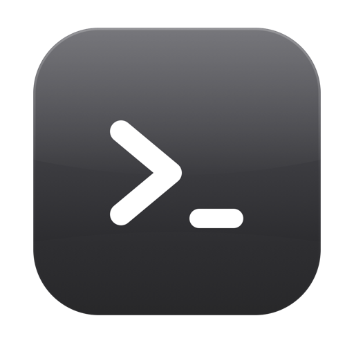
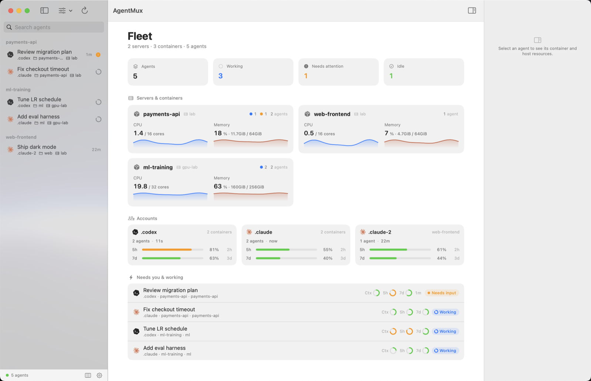
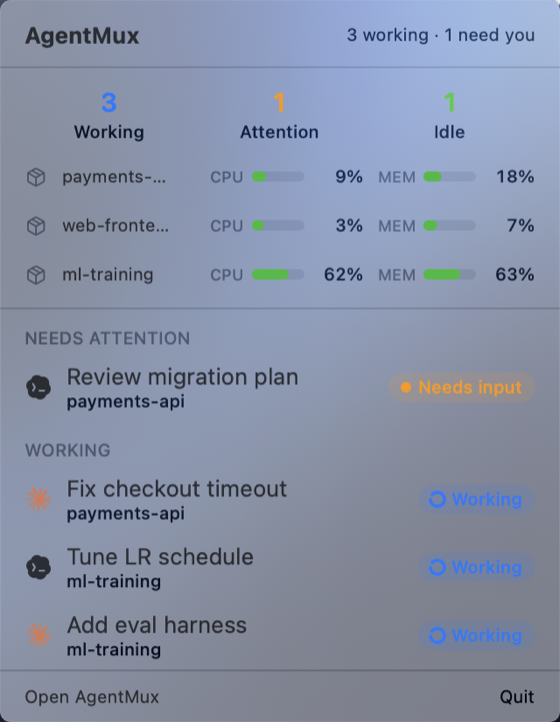

<div align="center">



# AgentMux

**A native Mac console for your remote AI coding agents, with zero server-side footprint.**

Monitor every Claude Code and Codex agent running in tmux on your servers from one window, over plain SSH.

English | [简体中文](README.zh-CN.md)

[](https://github.com/superpung/agentmux/releases/latest)
[](https://github.com/superpung/agentmux/releases)


</div>

<p align="center">
  
</p>
<p align="center">
  
</p>

## Why

AI coding agents increasingly run on remote machines: in containers, over SSH, inside tmux, often several at once across projects and accounts. Checking on them means SSHing in, attaching to the right pane, and squinting at a status line.

AgentMux turns that into one native Mac window. It discovers your agents, shows each one's status and usage at a glance, and lets you drop into the real terminal when you need to.

What makes it different:

- **Nothing to install on your servers.** AgentMux talks over plain SSH and reads standard tmux. There is no agent, daemon, or proprietary backend to deploy on the remote side.
- **Observe by default.** Auto-refresh only ever reads structural status. It never changes your servers, tmux, or agents on its own; every change is one you explicitly make.
- **Private.** It never reads conversation content, tokens, or credentials.
- **Truly native.** A real Mac app, not a web wrapper: menu-bar extra, system notifications, keyboard-driven.

## Features

- 🪟 **One window for every agent.** Claude Code and Codex across SSH hosts and Docker containers, grouped by container, project, session, or status, with search, pinning, and rename.
- 🔎 **Auto-discovery.** Point AgentMux at a host; it finds the containers and lets you pick which to monitor.
- 📊 **Fleet dashboard.** Per-account usage (5-hour and 7-day limits with reset countdowns), agent counts and activity, and per-container CPU and memory sparklines.
- 🎛️ **Usage at a glance.** Context window %, 5h / 7d limits, and the model and reasoning effort each agent is using, in a status bar whose fields you choose.
- 🖥️ **Live terminal mirror.** Open the actual tmux pane an agent runs in, softly resized to a readable font, or pop it out into its own window. Your keystrokes go to that pane only; your own tmux clients stay untouched.
- 🪟 **Several agents at once.** ⌘-click up to four agents in the sidebar to tile them, laid out to the window's shape (side by side, stacked, or a grid). Click a tile to type into it, ⌘] / ⌘[ to move between tiles, ⇧⌘↩ to zoom one. See [Several agents at once](#several-agents-at-once).
- ⌨️ **Command palette.** ⇧⌘P lists every command with its key, filtered as you type: open Files or a terminal, pin, rename, zoom, regroup or filter the sidebar, clear done marks, and more. ⌘K jumps to any agent or sends a prompt straight into one; typing `>` there switches to commands. Settings ▸ Shortcuts lists every key.
- 🚀 **Launch, resume & switch.** Start or resume a Claude Code or Codex agent in any directory, and switch a Claude or Codex account in place, resuming the same conversation.
- 🧭 **Activity & faults.** Working, waiting for input or approval, or idle: Claude Code's own reported state, else structural session-log fields and a screen verdict. An agent waiting out an API retry shows as **Retrying**. A turn that stopped on a usage limit or on an API error is marked in the sidebar, with the limit's reset time.
- ✅ **Done marks and working time.** An agent that finished while you were not looking is marked **Done** with a green check until you look at it, and sorts right after the agents that need you. A working agent shows for how long it has been working.
- 🔁 **Auto-continue.** Optionally sends `continue` to an agent stopped by a connection or server error, after a visible wait you can cancel, and never over your typing or an unsent draft. See [Notifications and auto-continue](#notifications-and-auto-continue).
- 🔔 **Notification inbox.** Finished, needs you, usage limit, stopped on an error, auto-continued: each goes to a list behind the toolbar bell with unread state, filters and clear, a Dock badge, and a desktop banner when you are not already looking at that agent.
- 🔬 **Resource inspector.** Per-agent CPU, memory and uptime, git working-tree status (branch, diff, ahead/behind), and host load, memory, disk and GPU.
- 📁 **Files.** Browse the remote working directory with rich previews: syntax-highlighted code, Markdown, CSV/TSV, Jupyter notebooks, HTML, RTF, SVG, PDF and images. Markdown, notebooks and HTML pages show their pictures, from the container or the web. The file shown and the folder listed update by themselves when they change remotely. Word, Excel and PowerPoint (and Pages, Numbers, Keynote) show as Quick Look shows them, with a searchable Text form; audio and video play; `.gz` / `.bz2` / `.xz` files show what they hold, zip and tar archives their listing, other binaries a hex view. Rendered formats switch to their source; ⌘F finds in every text and PDF preview (on a page or web view it switches to the text), also while the file list has the keyboard. Links in a preview open: a web page in your browser, another file or folder in the window (at its `#heading` or `#L12` line), with Back and Forward to return. Open a file in a Mac app (PowerPoint for a deck, say) from the toolbar or its context menu; the app gets a read-only copy. Drag files in from Finder to upload or out to Finder to download, and create, rename or delete files and folders.
- 🧩 **tmux management.** Create or kill sessions, windows and panes, plus a throwaway shell with ⌘T.
- 📍 **Menu-bar extra.** The agents that need you, are done or are working, live container CPU and memory (can be hidden in Settings), and jump to any agent without opening the main window.
- 🔒 **Privacy-first.** Auto-refresh is read-only and structural, never conversation content, tokens, or credentials.
- 🆕 **Update notifications.** A new release is announced once in a notification that opens its page; no update window, nothing installed for you. AgentMux ▸ Check for Updates… asks at once.

## How it compares

Every similar tool *launches* agents for you (in local git worktrees, or on its own runtime). AgentMux instead watches the ones you **already run** on remote machines:

| Capability | AgentMux | herdr | Orca | Conductor | Claude Squad | kero | Lody | herdrm | waku |
|---|:--:|:--:|:--:|:--:|:--:|:--:|:--:|:--:|:--:|
| Watch already-running agents (no runtime, nothing to launch) | ✅ | ❌ | ❌ | ❌ | ❌ | ❌ | ❌ | 🔶 | ❌ |
| Remote over SSH | ✅ | 🔶 | ❌ | ❌ | ❌ | ❌ | 🔶 | 🔶 | ❌ |
| Auto-discover Docker containers | ✅ | ❌ | ❌ | ❌ | ❌ | ❌ | ❌ | ❌ | ❌ |
| Host/container metrics, incl. GPU | ✅ | ❌ | ❌ | ❌ | ❌ | ❌ | ❌ | ❌ | ❌ |
| Switch Claude/Codex account in place | ✅ | ❌ | ❌ | ❌ | ❌ | ❌ | ❌ | ❌ | ❌ |
| Native Mac app (no Electron/TUI) | ✅ | ❌ | ❌ | ✅ | ❌ | ✅ | ❌ | ✅ | ✅ |

<sub>🔶 partial: remote over the tool's own runtime or daemon, not SSH; herdrm also requires adopting herdr.</sub>

Download size, native apps only, smallest first:

| App | Download |
|---|--:|
| **AgentMux** | **6.4 MB** |
| kero | 16.8 MB |
| waku | 27.6 MB |
| herdrm | 35 MB |
| Conductor | 84 MB |
| Lody | 181 MB |
| Orca | 255 MB |

## Requirements

- A Mac with **Apple Silicon**, running **macOS 14 or later**.
- **SSH access** to your host(s). AgentMux authenticates through `ssh` and `ssh-agent`; it handles no passwords or keys itself. An `~/.ssh/config` alias or `user@host` is all it needs.
- On the remote side: **tmux**, optionally **Docker**, and your agents running inside tmux.
- For Claude usage metrics (context / 5h / 7d), a one-time status-line sidecar (see [Configuration](#configuration)).

## Install

1. Download the latest `AgentMux-x.y.z-macos-arm64.zip` from the [**Releases**](https://github.com/superpung/agentmux/releases/latest) page.
2. Unzip it and move **AgentMux.app** to `/Applications`.
3. The app is ad-hoc signed and not notarized, so macOS Gatekeeper warns on first launch. Either right-click the app and choose **Open**, or clear the quarantine flag:

   ```sh
   xattr -dr com.apple.quarantine /Applications/AgentMux.app
   ```

Prefer to build from source? See [docs/development.md](docs/development.md).

## Configuration

Everything is set up in the app's **Settings** window:

1. **Hosts**: add an SSH destination (an `~/.ssh/config` alias, or `user@host`).
2. **Containers**: pick which auto-discovered containers to monitor.

To see Claude context and rate-limit usage, copy [`scripts/agentmux-statusline.sh`](scripts/agentmux-statusline.sh) into each container and point Claude Code's `statusLine` setting at it. Codex usage is read automatically, with no extra setup.

## Several agents at once

⌘-click (or ⇧-click) up to four agents in the sidebar and they share the detail area; a plain click goes back to one.

- **Layout** follows the area's shape and keeps every tile wide enough for an agent's TUI (about 80 columns) when it can. On a landscape window: two side by side, three as one tall tile beside two stacked, four as a 2×2 grid. On a portrait or narrow window they stack top to bottom. Resizing the window does not flip the layout back and forth near the switch point.
- **Focus.** Keys go to one tile at a time, marked by an accent line under its header. Click a tile, or use ⌘] / ⌘[, to move focus. ⇧⌘↩ zooms the focused tile to the full area and back; the others keep running and keep their size.
- **Closing.** A tile's × (or ⌘-clicking its row again) takes it out; its mirror stays warm like any recently viewed agent.
- Each tile sizes its agent's tmux window to the tile, as the single view does with the full area. If you also have that window attached elsewhere, you see it at the tile's size while the tile is open.

## Notifications and auto-continue

The toolbar bell (⌥⌘N) opens the inbox:

| Event | When |
|---|---|
| Finished | A turn ended normally (working → idle). |
| Needs you | The agent waits for input or an approval. |
| Usage limit | The turn stopped on a usage limit; shows which one and when it resets. |
| Stopped on an error | The turn stopped on an API error after the agent's own retries. |
| Auto-continued | AgentMux sent `continue` (see below). |
| Auto-continue stopped | Tries ran out, or a try was skipped (an unsent draft) or failed. |

Items are kept across launches, newest first by day, with unread dots, an All / Unread filter, mark read or unread, delete (hover, swipe or right-click), Mark All as Read, Clear Read and Clear All. The Dock icon shows the unread count. A desktop banner appears unless that agent is on screen, in a window that is not minimized, hidden or covered; clicking a banner or a row opens the agent. Banners can be turned off in Settings; the inbox always records. A banner for an agent that needs you (or stopped on an error or a limit) and one for a finished turn play different sounds, each chosen from the Mac's alert sounds in Settings, or none.

**Done marks.** An agent whose turn finished while it was not on screen is **Done** until it is: a green check in the sidebar and tile header, a Done chip and section in the menu bar and the dashboard. Looking at an agent marks its notifications read and takes their banners out of Notification Center. Clear in the menu bar's Done section clears every mark. Done agents sort after those that need you and before working ones; one you open keeps its place until you leave it, so the row does not move away as you click it.

**How a stopped turn is recognized.** For Claude Code, the last real record of the session log is an API error: its error code and quota fields (`rate_limit` with a rejected quota is a usage limit; `server_error`, `unknown` and transient 429s are errors). For Codex, which writes no errors to its rollout, the last error line on its screen comes after its last output line; a usage-limit message is a usage limit and Esc's "Conversation interrupted" is not an error. Both are reduced to a verdict inside the container; the message text never leaves it.

**Auto-continue** (Settings ▸ General, off by default) types `continue` (configurable) into an agent stopped by a connection or server error, which is what Claude Code's own error docs advise after a dropped response. Usage limits, auth and billing errors, and rejected requests are left alone.

- **When.** 10 s after the error, then 1 min, then 5 min, up to 3 tries in a row (configurable); a turn that finishes normally resets the count. Agents already stopped when AgentMux starts, or when the setting is turned on, are included.
- **Visible.** While a try waits, the sidebar row and the tile header show a ring that fills up until it is sent, and the status bar adds **Send Now** and **Cancel** (also in the row's right-click menu). Cancel stops tries until that error clears.
- **Safe.** Right before typing, inside the container: the agent must still be stopped on the same error and still in front (never a shell); nobody may have typed into its window in the last 30 s (an attached terminal, or this app); and its input line must be empty, ignoring the agent's dimmed placeholder or suggestion. Otherwise it waits, or skips and says so in the inbox.
- It runs only while AgentMux is open.

For long unattended Claude Code runs, also set `CLAUDE_CODE_RETRY_WATCHDOG=1` in each account's `settings.json` `env`: Claude Code then retries capacity errors (429/529) indefinitely and other transient errors for hours before giving up, so fewer turns stop at all. Codex's built-in OpenAI provider does not let its retry counts be changed.

## How it works

Each refresh makes one read-only SSH connection that inventories processes and tmux. Opening an agent attaches a live view over tmux control mode on a private, per-view session, so your own tmux clients and layout are never disturbed. Only structural status is ever read, never the conversation.

## Privacy & security

- **Read-only auto-refresh.** Polling only inventories processes and tmux. It never changes your servers, containers, tmux, or agents.
- **You make every change.** Writes happen only when you act: opening a terminal and typing, sending a prompt, launching, resuming or switching an agent, managing tmux, or working with files. The one automatic write is auto-continue, and only after you turn it on: it types its message into an agent stopped on an error, under the checks above.
- **No conversation content.** Only structural log fields (event type, error code, token counts, timestamps) are read, never message text. Screen checks (working or idle, an error line, an empty input line) run inside the container and return only a verdict.
- **No secrets.** Tokens and credentials are never read. Account de-duplication uses only non-secret account id fields.
- **One outside request.** About once a day the app reads this repository's public release feed on github.com to learn of a new version (Settings ▸ General ▸ Check for updates turns it off). Nothing about you or your agents is sent.

## Development

Build instructions, the CLI tool, source layout, and architecture notes are in [docs/development.md](docs/development.md).

## License

AgentMux is a personal project. Bundled third-party components and their licenses are listed in [THIRD_PARTY_NOTICES.md](THIRD_PARTY_NOTICES.md).
