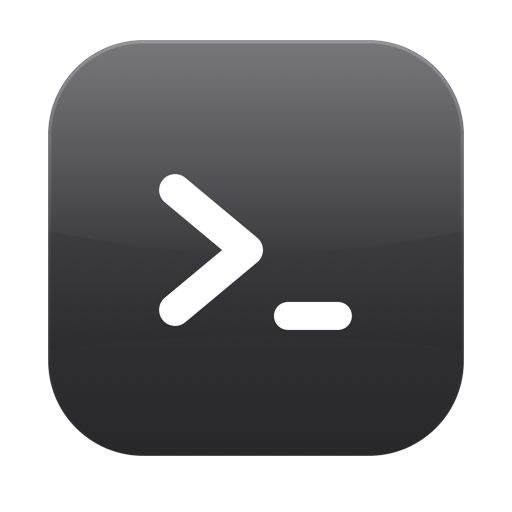
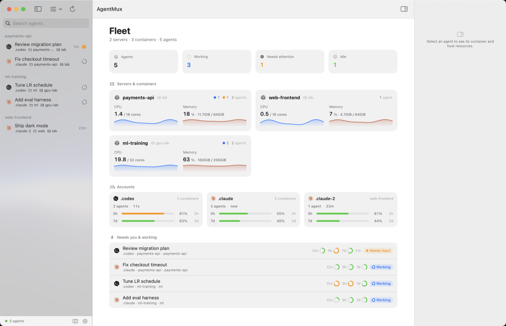
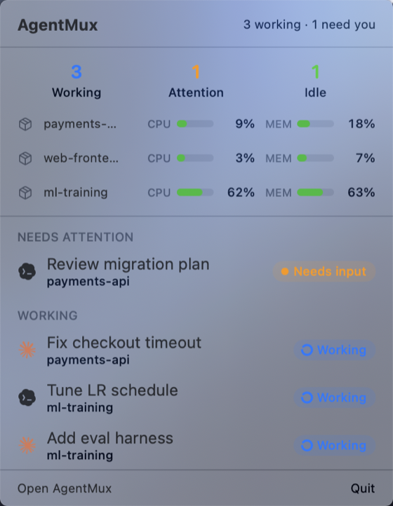

<div align="center">



# AgentMux

**A native Mac console for your remote AI coding agents, with zero server-side footprint.**

Monitor every Claude Code and Codex agent running in tmux on your servers from one window, over plain SSH.

English | [简体中文](README.zh-CN.md)

[](https://github.com/superpung/agentmux/releases/latest)
[](https://github.com/superpung/agentmux/releases)


</div>

<p align="center">
  
</p>
<p align="center">
  
</p>

## Why

AI coding agents increasingly run on remote machines: in containers, over SSH, inside tmux, often several at once across projects and accounts. Checking on them means SSHing in, attaching to the right pane, and squinting at a status line.

AgentMux turns that into one native Mac window. It discovers your agents, shows each one's status and usage at a glance, and lets you drop into the real terminal when you need to.

What makes it different:

- **Nothing to install on your servers.** AgentMux talks over plain SSH and reads standard tmux. There is no agent, daemon, or proprietary backend to deploy on the remote side.
- **Observe by default.** Auto-refresh only ever reads structural status. It never changes your servers, tmux, or agents on its own; every change is one you explicitly make.
- **Private.** It never reads conversation content, tokens, or credentials.
- **Truly native.** A real Mac app, not a web wrapper: menu-bar extra, system notifications, keyboard-driven.

## Features

- 🪟 **One window for every agent.** Claude Code and Codex across SSH hosts and Docker containers, found automatically, grouped by container, project, session or status.
- 🖥️ **Live terminal.** The agent's real tmux pane, resized to a readable font, in the main window or a window of its own; your own tmux clients stay untouched.
- 🧱 **Several at once.** ⌘-click up to four agents to tile them as cards, laid out to the window's shape.
- 🧭 **Status at a glance.** Working, needs you, done, retrying, or stopped on a usage limit or an error, and how long each has been working.
- 🎛️ **Usage.** Context %, 5-hour and 7-day limits with reset times, and the model and effort, per agent and per account.
- 📊 **Dashboard and menu bar.** Every account's limits, the agents that need you, and live CPU and memory per container.
- 🔔 **Notifications.** An inbox with a banner only when you are not looking, and optional auto-continue after a connection or server error.
- 🚀 **Launch, resume and switch.** Start or resume an agent in any directory (⌘N), or move it to another account mid-conversation.
- 📁 **Files.** Browse and preview the remote working directory: code, Markdown, notebooks, PDF, Office documents and more.
- 🔬 **Resources.** Per-agent CPU, memory and git status; host load, disk and GPU.
- 🧩 **tmux.** Create or kill sessions, windows and panes, or open a throwaway shell in any container (⌘T).
- ⌨️ **Keyboard first.** ⌘K jumps to any agent, ⇧⌘P runs any command, and Settings ▸ Shortcuts lists every key.
- 🆕 **Update notifications.** A new release is announced in a notification; nothing installs itself.

How tiles, notifications, auto-continue and file previews work in detail: [docs/usage.md](docs/usage.md).

## How it compares

Every similar tool *launches* agents for you (in local git worktrees, or on its own runtime). AgentMux instead watches the ones you **already run** on remote machines:

| Capability | AgentMux | herdr | Orca | Conductor | Claude Squad | kero | Lody | herdrm | waku | Paseo |
|---|:--:|:--:|:--:|:--:|:--:|:--:|:--:|:--:|:--:|:--:|
| Watch already-running agents (no runtime, nothing to launch) | ✅ | ❌ | ❌ | ❌ | ❌ | ❌ | ❌ | 🔶 | ❌ | ❌ |
| Remote over SSH | ✅ | 🔶 | ❌ | ❌ | ❌ | ❌ | 🔶 | 🔶 | ❌ | 🔶 |
| Auto-discover Docker containers | ✅ | ❌ | ❌ | ❌ | ❌ | ❌ | ❌ | ❌ | ❌ | ❌ |
| Host/container metrics, incl. GPU | ✅ | ❌ | ❌ | ❌ | ❌ | ❌ | ❌ | ❌ | ❌ | ❌ |
| Switch Claude/Codex account in place | ✅ | ❌ | ❌ | ❌ | ❌ | ❌ | ❌ | ❌ | ❌ | ❌ |
| Native Mac app (no Electron/TUI) | ✅ | ❌ | ❌ | ✅ | ❌ | ✅ | ❌ | ✅ | ✅ | ❌ |

<sub>🔶 partial: remote only to the tool's own runtime or daemon on the far machine (Paseo can reach its daemon through an SSH tunnel); herdrm also requires adopting herdr.</sub>

Download size, native apps only, smallest first:

| App | Download |
|---|--:|
| **AgentMux** | **6.4 MB** |
| kero | 16.8 MB |
| waku | 27.6 MB |
| herdrm | 35 MB |
| Conductor | 84 MB |
| Lody | 181 MB |
| Orca | 255 MB |

## Requirements

- A Mac with **Apple Silicon**, running **macOS 14 or later**.
- **SSH access** to your host(s). AgentMux authenticates through `ssh` and `ssh-agent`; it handles no passwords or keys itself. An `~/.ssh/config` alias or `user@host` is all it needs.
- On the remote side: **tmux**, optionally **Docker**, and your agents running inside tmux.
- For Claude usage metrics (context / 5h / 7d), a one-time status-line sidecar (see [Configuration](#configuration)).

## Install

1. Download the latest `AgentMux-x.y.z-macos-arm64.zip` from the [**Releases**](https://github.com/superpung/agentmux/releases/latest) page.
2. Unzip it and move **AgentMux.app** to `/Applications`.
3. The app is ad-hoc signed and not notarized, so macOS Gatekeeper warns on first launch. Either right-click the app and choose **Open**, or clear the quarantine flag:

   ```sh
   xattr -dr com.apple.quarantine /Applications/AgentMux.app
   ```

Prefer to build from source? See [docs/development.md](docs/development.md).

## Configuration

Everything is set up in the app's **Settings** window:

1. **Hosts**: add an SSH destination (an `~/.ssh/config` alias, or `user@host`).
2. **Containers**: pick which auto-discovered containers to monitor.

To see Claude context and rate-limit usage, copy [`scripts/agentmux-statusline.sh`](scripts/agentmux-statusline.sh) into each container and point Claude Code's `statusLine` setting at it. Codex usage is read automatically, with no extra setup.

## How it works

Each refresh makes one read-only SSH connection that inventories processes and tmux. Opening an agent attaches a live view over tmux control mode on a private, per-view session, so your own tmux clients and layout are never disturbed. Only structural status is ever read, never the conversation.

## Privacy & security

- **Read-only auto-refresh.** Polling only inventories processes and tmux. It never changes your servers, containers, tmux, or agents.
- **You make every change.** Writes happen only when you act: opening a terminal and typing, sending a prompt, launching, resuming or switching an agent, managing tmux, or working with files. The one automatic write is auto-continue, and only after you turn it on: it types its message into an agent stopped on an error, under the checks above.
- **No conversation content.** Only structural log fields (event type, error code, token counts, timestamps) are read, never message text. Screen checks (working or idle, an error line, an empty input line) run inside the container and return only a verdict.
- **No secrets.** Tokens and credentials are never read. Account de-duplication uses only non-secret account id fields.
- **One outside request.** About once a day the app reads this repository's public release feed on github.com to learn of a new version (Settings ▸ General ▸ Check for updates turns it off). Nothing about you or your agents is sent.

## Development

Build instructions, the CLI tool, source layout, and architecture notes are in [docs/development.md](docs/development.md).

## License

AgentMux is a personal project. Bundled third-party components and their licenses are listed in [THIRD_PARTY_NOTICES.md](THIRD_PARTY_NOTICES.md).
